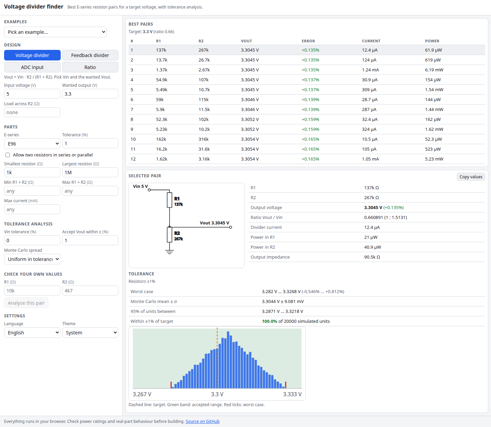

# Voltage Divider Finder

Find the best resistor pair for a voltage divider. Give it Vin and the output you want, or a regulator's feedback reference, or an ADC's full-scale voltage. It searches the E-series (E3 to E192), optionally including two-resistor series and parallel combinations, and ranks the pairs by error. It then shows the worst-case and Monte Carlo spread of the real output once the resistor tolerances are applied.

**Try it: [hermes98761234.github.io/voltage-divider-finder](https://hermes98761234.github.io/voltage-divider-finder/)**

[](https://github.com/hermes98761234/voltage-divider-finder/actions/workflows/deploy.yml)



## Features

- **Four design modes.** A plain divider (Vin to Vout), a regulator feedback divider (`Vout = Vref (1 + R1/R2)`, with common Vref presets), an ADC input (scale the maximum input to the ADC reference, with source impedance and error in LSB), and a bare ratio.
- **E3, E6, E12, E24, E48, E96 and E192**, with the standard tables and a default tolerance per series.
- **Series and parallel combinations** of two resistors, for when no single pair is close enough.
- **Constraints**: smallest and largest resistor, minimum and maximum R1 + R2, and a maximum divider current (for battery sensing).
- **Loaded dividers.** A load across R2 is compensated in the search, and the selected pair shows the output with and without the load.
- **Tolerance analysis.** Worst-case Vout over every resistor corner plus the Vin or Vref tolerance, and a 20,000-draw Monte Carlo (uniform or gaussian) with mean, sigma, 95% range, the share of units inside your accepted band, and a histogram.
- **Check your own values.** Type the R1 and R2 you already have (`4k7`, `10k`, `2M2`) and get the same analysis.
- **Examples**, a schematic SVG, current and power per resistor, copy-to-clipboard.
- **English or Ukrainian, light, dark or system theme.** Settings are remembered in the browser, and nothing leaves it.

## How it works

R1 is the upper resistor and R2 the lower one. For a target ratio `r = Vout/Vin`, the ideal R2 for any R1 is `R1 r / (1 - r)`. With a load RL across R2 it is the parallel combination R2 ‖ RL that must equal that value, so `R2 = Rb RL / (RL - Rb)`. The search tries every R1 candidate, binary-searches the sorted candidate list for the values around the ideal R2, applies the constraints, and ranks by absolute error, then by number of parts. It runs in a Web Worker and is checked against a brute-force scan of all pairs in the tests.

E48, E96 and E192 values are `10^(i/n)` rounded to three significant digits, as in IEC 60063 (with the standard's 9.20 in E192). E3 to E24 use the standard tables.

Vout is monotonic in each resistor and in the source voltage, so the worst case is found at the corners of the tolerance box. For a combination of two resistors every part carries the tolerance. The Monte Carlo draws each resistor separately from a seeded generator, so a given design always produces the same histogram.

Real parts also have temperature drift, voltage coefficients and ADC input leakage, which are not modelled. Check power ratings before you build.

## Quick start

You need [Node.js](https://nodejs.org/) 22.

```bash
git clone https://github.com/hermes98761234/voltage-divider-finder.git
cd voltage-divider-finder
npm install
npm run dev       # http://localhost:5173
npm test          # E-series, divider search, tolerance, format and i18n tests
npm run build     # static site in dist/
```

## License

MIT
